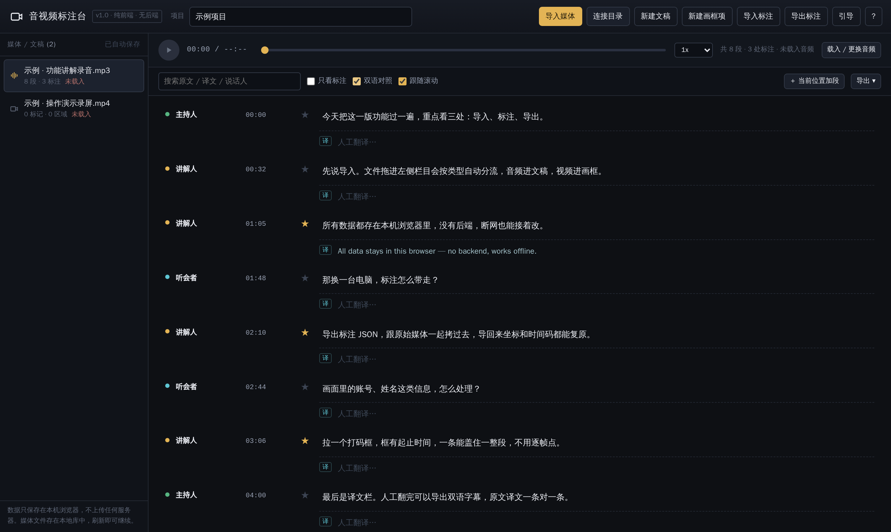
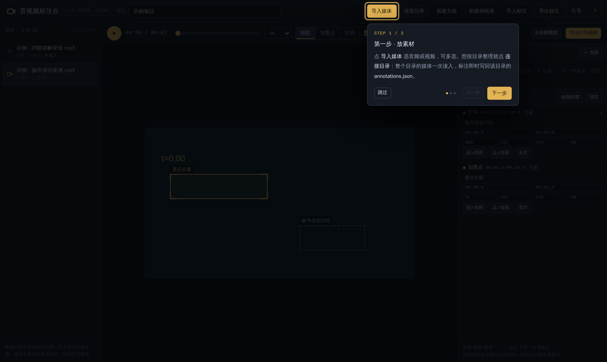
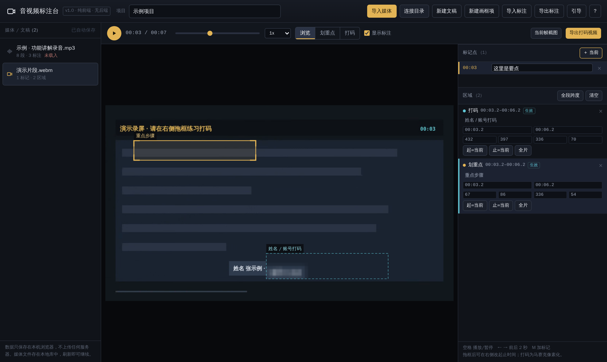

# 音视频标注台

一个网页搞定三件事：**录音文稿校对**、**视频划重点**、**视频打码**。纯前端单文件，**没有后端、没有账号、不向任何服务器上传**。

- 在线版：部署后访问 `https://<你的账号>.github.io/media-annotator/`
- 离线版：下载 `index.html`，双击用 Chrome / Edge 打开即可（功能一致，只是「连接目录」需要 https 或 localhost）



## 为什么可以放心用

| 关注点 | 这个工具的做法 |
|---|---|
| 数据去哪了 | 只存在你这台机器的浏览器里（IndexedDB），或你亲手选的本地目录 |
| 有没有偷偷上传 | 没有后端、没有接口、没有第三方脚本/字体/CDN，断网也能用 |
| 能不能审计 | 整个工具就是一个 HTML 文件，直接搜索源码就能确认没有任何上传逻辑 |
| 分享给别人 | 导出「只读预览 HTML」，数据打包在里面，对方双击打开就能看，依然不联网 |

## 三步上手

1. **放素材**：点「导入媒体」选音频/视频，或点「连接目录」把整个目录读进来（媒体 + 已有标注一起恢复）。
2. **标注**：左边选中一项。音频逐段校对文字、★ 标重点、写人工译文；视频选「划重点」或「打码」，在画面上拖一个框。
3. **带走结果**：点「导出标注」，拿单一数据文件或只读预览 HTML。

首次访问会自动走一遍三步引导（右上「引导」可重看）。



## 能做什么

### 录音 / 音频：文稿校对与文字标注
- 逐段改说话人、改时间码、改原文；点时间码直接跳转复听
- ★ 标记重点段，可只看重点
- 每段独立「人工译文」栏，可开**双语对照**；导出**双语 SRT**
- 导入现成文稿：`.txt`（`【说话人】mm:ss` 格式）直接拖进来
- 搜索原文/译文/说话人；按时间码重排

### 视频：划重点与打码
- 画面上拖框即生成标注，框带**起止时间**（默认 3 秒，可改、可「起=当前/止=当前/全片」）
- 打码是**真实马赛克像素化 + 柔化**，不是半透明色块
- 视频标记点带备注，点时间码跳转
- 导出**当前帧截图**（标注烧进画面）或**整段打码视频**（逐帧重绘 + 实时录制）



### 人工翻译
不做机器翻译。每段一个译文框，人工填，双语并排核对，可导出原文 / 双语两版 SRT。

## 目录工作流：一份数据，不产生碎片

点「连接目录」选一个本地文件夹后：

1. 目录里的媒体自动建条目，有 `annotations.json` 就一并恢复标注，再按文件名自动挂回媒体；
2. 首次连接会在目录里生成一份 `README.md`，用来说明数据格式；
3. 之后**每次修改都即时覆盖写入同一个 `annotations.json`**（防抖 1.2 秒，切后台/关页面会立刻落盘），不会给目录摊出一堆小文件。

```
你的目录/
├── annotations.json      ← 唯一的数据文件（全部文稿、标记、区域、译文）
├── README.md             ← 自动生成的说明
├── 会议录音.mp3          ← 原样保留，不改写、不上传
└── 录屏.mp4
```

## 导出物一览

| 导出 | 用途 | 形态 |
|---|---|---|
| 项目 JSON（单一数据文件） | 换机迁移、归档 | 一个 `.json` |
| 只读预览 HTML | 发给别人复核，只能看不能改 | 一个 `.html`（可选内嵌媒体，≤80MB） |
| 双语 SRT / TXT / Markdown | 字幕与校对稿 | 文本 |
| 当前帧截图 | 截图佐证 | PNG，标注已烧入 |
| 打码视频 | 交付/演示 | MP4（VP9/Opus），实时录制 |

## 数据格式（annotations.json）

```json
{
  "app": "音视频标注台",
  "schema": 3,
  "name": "项目名称",
  "exportedAt": "2026-11-16T…",
  "items": [
    { "kind": "audio", "name": "会议.mp3",
      "segments": [{ "sp": "说话人", "sec": 0, "text": "原文", "tr": "译文", "mark": true }] },
    { "kind": "video", "name": "录屏.mp4",
      "marks": [{ "t": 4.2, "note": "备注" }],
      "regions": [{ "kind": "blur", "x": 100, "y": 200, "w": 180, "h": 60,
                   "t0": 3.5, "t1": 6.5, "label": "账号" }] }
  ]
}
```

区域坐标按**媒体原始像素**记录，与播放时的缩放无关；换同尺寸素材可直接复用。

## 浏览器与限制

- 建议 Chrome / Edge。「连接目录」用的是 File System Access API，需要 https 或 localhost（GitHub Pages 满足；`file://` 双击打开时用不了，但浏览器本地库仍然可用）。
- 音视频能不能播取决于浏览器对该编码的支持（MP4/H.264、MP3、WAV 最稳）。
- 打码是**静态矩形只在一定时间内生效**，画面里会移动的敏感信息要沿时间轴多打几段框，本工具不做逐帧跟踪。
- 「导出打码视频」是实时重绘录制，耗时约等于片长，期间不要切走标签页；输出为 VP9/Opus 编码，需要 H.264 时用本地转码工具再过一遍。
- 只读预览包默认内嵌媒体 ≤ 80MB，超出则不内嵌（仍可查看标注与文稿）。

## 本地运行

```bash
npm start                 # 零依赖静态服务器，默认 4180
# 或
python3 -m http.server 4180
```

打开 `http://127.0.0.1:4180/index.html`（localhost 上「连接目录」可用）。

## 测试与 CI

```bash
npm install
npx playwright install chromium   # 国内网络慢可加 --mirror
npm test
```

覆盖 9 条端到端用例：首屏无报错、新手引导、文稿编辑持久化、SRT 导出、加段与搜索、视频拖框与起止时间、**打码像素级校验**、目录即时写入（单一文件 + README）、只读预览包的只读性与可播放性、JSON 往返。

每次 push / PR 由 GitHub Actions 跑一遍（`.github/workflows/ci.yml`）。

## 部署（GitHub Pages）

推送到 `dev`（或 `main`）分支自动触发 `.github/workflows/pages.yml`：把 `index.html` 与文档复制到 `_site` 后发布，无需任何构建步骤。

首次需要在仓库 **Settings → Pages → Source** 选 **GitHub Actions**。

## 隐私设计说明

- 无后端、无数据库、无账号体系、无统计埋点、无 Cookie、无第三方依赖（连字体都用系统字体，不请求 CDN）。
- 媒体只在本机解码，不上传；目录写入仅发生在你授权的那一个目录里。
- 只读预览包同样不联网：数据与媒体以 JSON / data URL 内嵌在同一个 HTML 里。
- 唯一会"离开本机"的动作，是你自己把导出的文件发给别人。

## 常见问题

**连接目录按钮没反应？** 用 Chrome/Edge，且页面必须跑在 https 或 `http://localhost`（不要直接双击 html）。

**换了台电脑怎么继续？** 把整个目录拷过去（`annotations.json` + 媒体），在新机器上「连接目录」即可恢复。

**媒体条目显示「未载入」？** 说明这条只有标注没有文件，重新「连接目录」或点「载入 / 更换音频（视频）」挂上对应文件即可。

**打了码却还能看到内容？** 检查右侧该区域的起止时间是否覆盖当前播放位置——区域只在起止区间内生效。

**导出视频很慢？** 正常，实时录制，8 秒片子大约 8 秒。

## License

MIT
